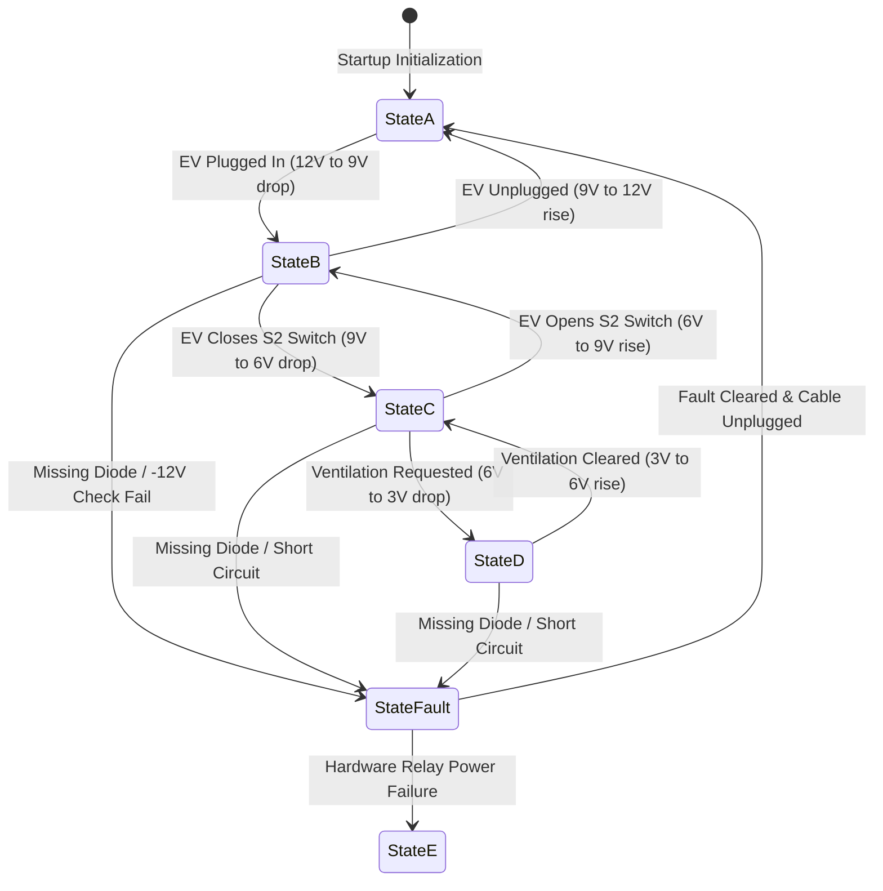
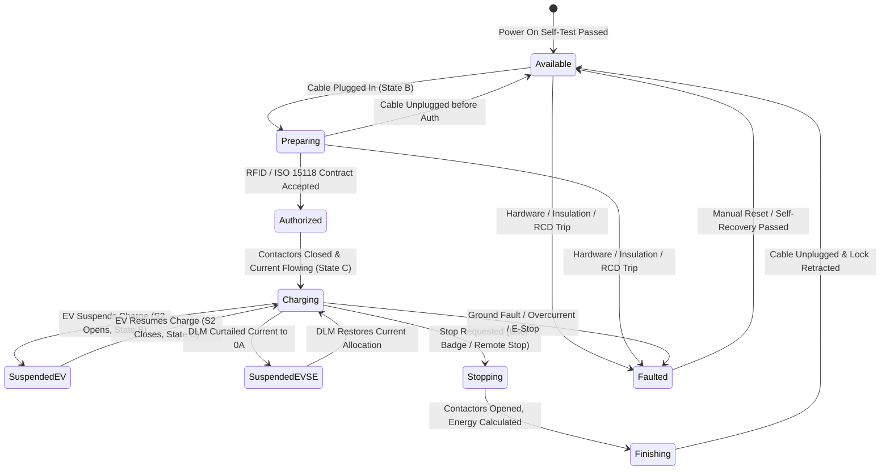

# Stanchion Architecture Specification

Stanchion is an embedded controller and real-time microgrid energy router designed for commercial and fleet electric vehicle supply equipment (EVSE). Built around a deterministic Berry runtime with native C acceleration, Stanchion implements the full protocol stack spanning IEC 61851-1 analog signaling, ISO 15118-2/20 digital vehicle communication, and OCPP 2.0.1 Central System management.

This document details the layered architectural model, inter-module communication pathways, finite state machines, and hardware isolation boundaries.

---

## 1. System Overview and Layered Hierarchy

The software architecture is partitioned into six decoupled layers with strict dependency flow. Higher-level layers orchestrate business and energy policies, while lower-level layers interface with physical transducers and communication buses.

```mermaid
flowchart TD
    subgraph Layer5 ["Layer 5: Station Orchestration & HMI"]
        MAIN["Station Main & CLI (main.be)"]
        HMI["Local HMI & Status Display (hmi.be)"]
        COORD["Session Coordinator (session.be)"]
        TELEM["Telemetry Engine (telemetry.be)"]
    end

    subgraph Layer4 ["Layer 4: Energy Management & Policy"]
        DLM["Dynamic Load Management (dlm.be)"]
        PHASE["Phase Balancer (phase_balance.be)"]
        SOLAR["Solar PV + BESS Optimizer (solar_storage.be)"]
        V2G["V2G Grid Dispatcher (v2g.be)"]
        FREQ["FFR / FCR Droop Governor (freq_regulation.be)"]
        THERM["Transformer Thermal Model (thermal_model.be)"]
        POLICY["Policy & Billing Engine (policy/engine.be)"]
        SCHED["Fleet Overnight Scheduler (fleet_scheduler.be)"]
    end

    subgraph Layer3 ["Layer 3: Network & Protocols"]
        OCPP["OCPP 2.0.1 Protocol Engine (ocpp/)"]
        DEVMOD["Device Model Schema (device_model_schema.be)"]
        ISO15118["ISO 15118-20 DC & V2G Engine (iso15118_20_dc.be)"]
        PKI["V2G PKI & Contract Certs (iso15118_v2g_pki.be)"]
        STORE["Offline Transaction Store (offline_store.be)"]
        CAN["CAN 2.0B Vehicle Bus (can_diagnostics.be)"]
    end

    subgraph Layer2 ["Layer 2: Core Infrastructure"]
        FSM["Hierarchical Finite State Machine (fsm.be)"]
        EVBUS["Publish/Subscribe Event Bus (events.be)"]
        TIMERS["Software Timer Engine (timer.be)"]
        CFG["Hierarchical Config Registry (config.be)"]
        LOG["Structured Diagnostic Logger (logger.be)"]
    end

    subgraph Layer1 ["Layer 1: Hardware Abstraction Layer (HAL)"]
        PILOT["Control Pilot PWM Transceiver (pilot.be)"]
        METER["Bi-directional Meter Reader (meter.be)"]
        RELAY["Contactor Driver & Weld Sense (contactor.be)"]
        SAFE["Safety Interlocks & RCD-B Guard (safety.be)"]
        LOCK["Motorized Solenoid Lock (lock.be)"]
        IMD["Bender IMD Insulation Monitor (insulation_monitor.be)"]
        COOL["Active Liquid Cable Chiller (cooling_loop.be)"]
    end

    subgraph Layer0 ["Layer 0: Native Host & Bare Metal"]
        BERRY["Berry Bytecode VM (BE_STACK_START=4096)"]
        HOST["Native C Host Bridge (host_main.c)"]
        PERIPH["Physical ADC / GPIO / PWM / UART / SPI Peripherals"]
    end

    MAIN --> COORD
    COORD --> POLICY
    COORD --> DLM
    COORD --> OCPP
    COORD --> ISO15118
    DLM --> PHASE
    DLM --> SOLAR
    DLM --> FREQ
    DLM --> THERM
    OCPP --> STORE
    OCPP --> DEVMOD
    ISO15118 --> PKI
    COORD --> PILOT
    COORD --> METER
    COORD --> RELAY
    COORD --> LOCK
    SAFE --> RELAY
    COOL --> COORD
    IMD --> SAFE
    PILOT --> EVBUS
    METER --> EVBUS
    RELAY --> EVBUS
    SAFE --> EVBUS
    EVBUS --> COORD
    EVBUS --> TELEM
    COORD --> BERRY
    BERRY --> HOST
    HOST --> PERIPH
```



---

## 2. Event-Driven Messaging and Execution Loop

Stanchion uses an asynchronous, non-blocking execution loop governed by cooperative event scheduling. The system avoids preemptive thread locking overhead by executing all business logic within a single-threaded deterministic Berry runtime.

### Event Bus Architecture

The `EventBus` (`core/events.be`) implements a zero-allocation publish/subscribe dispatcher:

1. **Event Registration**: Components register interest in specific event identifiers (e.g., `PILOT_STATE_CHANGED`, `METER_VALUES_UPDATED`, `SAFETY_FAULT_DETECTED`, `GRID_FREQUENCY_ALERT`).
2. **Synchronous and Queued Dispatch**: Normal events are handled synchronously within the tick frame. Safety-critical events (`EMERGENCY_STOP`, `GROUND_FAULT`, `OVERCURRENT`) invoke direct callback chains that immediately isolate the high-voltage contactors before returning control to the caller.
3. **Payload Typing**: Event payloads are structured Berry maps containing timestamped telemetry, diagnostic metadata, and channel references.

```
+-------------------------------------------------------------------+
|                        Execution Frame Loop                       |
+-------------------------------------------------------------------+
  |
  +---> 1. Sample ADC pins (Pilot voltage, IMD resistance, RCD DC leakage)
  |
  +---> 2. Update HAL drivers (Moving average filters, weld detection)
  |
  +---> 3. Process Software Timers (Heartbeats, meter intervals, watchdogs)
  |
  +---> 4. Pump OCPP & ISO 15118 message queues (Frame parsing, auth)
  |
  +---> 5. Execute Smart Charging Cycle (DLM water-filling, FFR droop)
  |
  +---> 6. Update EVSE State Machines (Transitions, contactor sequencing)
  |
  +---> 7. Flush Offline Transaction Store & Telemetry buffers
  |
  +---> 8. Sleep until next 10 ms tick frame boundary
```

---

## 3. Finite State Machine (FSM) Specifications

Every charging channel is controlled by an instance of `EVSEChannel` (`station/evse.be`), which coordinates physical states, IEC 61851-1 pilot states, and OCPP 2.0.1 operational states.

### IEC 61851-1 Control Pilot State Machine

The analog control pilot line uses a 1 kHz pulse-width modulated (PWM) square wave with signal levels defined as:

- **State A (12V continuous)**: Standby. No electric vehicle is connected.
- **State B (9V continuous or PWM)**: Vehicle detected. Cable connected, EV not ready to charge.
- **State C (6V PWM)**: Vehicle ready. Charging active without closed-space ventilation.
- **State D (3V PWM)**: Vehicle ready. Charging active with ventilation required.
- **State E (0V)**: Power failure, disconnect from grid, or short circuit to pilot ground.
- **State F (-12V)**: Error state. Diode short circuit detected or EVSE offline.



### Station Session Coordinator State Transitions

The higher-level `SessionCoordinator` (`station/session.be`) bridges physical pilot signaling with user authorization, billing, and contactor actuation:



---

## 4. Hardware Abstraction Layer (HAL) & Isolation

The HAL decouples the Berry runtime from target hardware platforms (e.g., STM32, ESP32-S3, NXP i.MX, or simulated POSIX hosts). All physical interactions pass through isolated driver contracts.

### Driver Interfaces and Responsibilities

| Subsystem Module | Physical Interface | Responsibilities |
| :--- | :--- | :--- |
| `hal/pilot.be` | PWM Timer, ADC Channel | Generates 1 kHz square wave (0-100% duty cycle). Samples pilot voltage via 8x moving-average window. Validates negative diode pulse (-12V). |
| `hal/contactor.be` | High-side relay driver, Aux Sense GPIO | Drives safety contactor coils. Performs pre-closure and post-opening weld verification using auxiliary feedback contacts. |
| `hal/meter.be` | RS485 / Modbus RTU / SPI | Queries bi-directional active energy, reactive energy, phase currents (L1, L2, L3), voltages, and power factor. Computes running session import/export. |
| `hal/safety.be` | Fast Interrupt Pins | Monitors DC 6 mA residual current monitor (RCD-B), AC 30 mA ground fault, hardware emergency stop, and cabinet enclosure microswitches. |
| `hal/lock.be` | H-Bridge Motor Driver, Limit Switches | Actuates motorized locking pin to secure Type 2 or CCS connector during active charging. Verifies mechanical lock/unlock limit switches. |
| `hal/insulation_monitor.be`| Bender IMD A-ISOMETER Serial / Modbus | Continuously monitors DC bus isolation resistance to earth (kOhm). Triggers isolation fault when resistance drops below 500 Ohm/V standard. |
| `hal/cooling_loop.be` | PWM Fan/Pump Driver, PT1000 RTD | Regulates liquid coolant flow rate and chiller pump speed based on pin temperature sensors for high-power Megawatt Charging (MCS). |

---

## 5. Security and Cryptographic Boundaries

Stanchion enforces cryptographic isolation across all outbound and inbound interfaces:

1. **OCPP 2.0.1 Transport Security**: Supports Security Profile 1 (unencrypted for internal networks), Security Profile 2 (TLS with HTTP Basic Authentication), and Security Profile 3 (mutual TLS with client and server x.509 certificate validation).
2. **ISO 15118-20 V2G PKI**: Employs an integrated public key hierarchy (`protocols/iso15118_v2g_pki.be`) validating OEM Root CAs, Sub-CAs, Contract Certificates, and ECDSA signature verifications for Plug & Charge (PnC) autonomous billing.
3. **Internal Token Hashing**: RFID credentials, parent authorization IDs, and administrative tokens are hashed using salted FNV-1a with constant-time equality validation (`lib/token_hash.be`) to prevent timing side-channel attacks on memory-constrained controllers.
4. **Audit Trail Integrity**: Diagnostic security events (e.g., cabinet intrusion, invalid RFID scan bursts, firmware verification failures) are committed to an immutable append-only circular log (`diag/audit_trail.be`) with cryptographic chained hashing.
