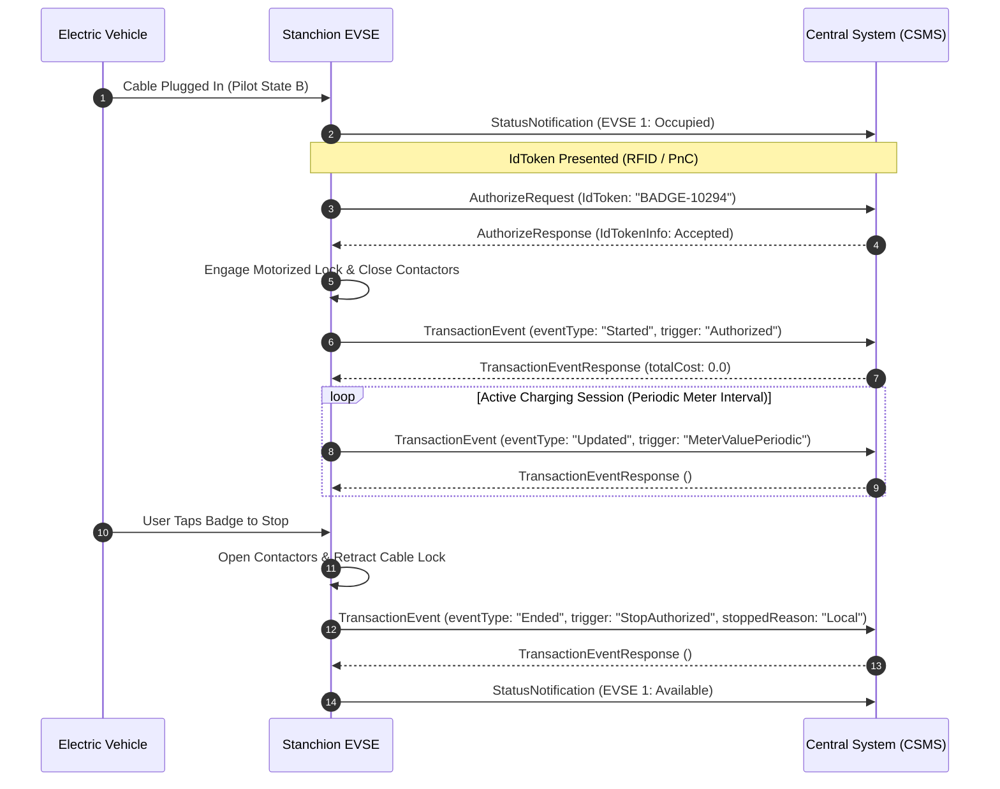

# Stanchion OCPP 2.0.1 Protocol Engine Specification

Open Charge Point Protocol (OCPP) 2.0.1 is the modern open standard governing bidirectional communication between Electric Vehicle Supply Equipment (EVSE) and Charging Station Management Systems (CSMS). Stanchion implements an embedded OCPP 2.0.1 protocol engine in pure Berry (`ocpp/`), providing complete message serialization, state tracking, and security profiles.

---

## 1. Protocol Architecture & JSON-RPC 2.0 Framing

OCPP 2.0.1 communication uses JSON-RPC framing transmitted over WebSockets (RFC 6455). Stanchion implements the protocol frame model (`ocpp/frame.be`):

```
+-------------------------------------------------------------------------------+
| Call [2, "<MessageId>", "<Action>", { <Payload> }]                            |
+-------------------------------------------------------------------------------+
| CallResult [3, "<MessageId>", { <Payload> }]                                  |
+-------------------------------------------------------------------------------+
| CallError [4, "<MessageId>", "<ErrorCode>", "<ErrorDesc>", { <ErrorDetails> }] |
+-------------------------------------------------------------------------------+
```

### Supported OCPP 2.0.1 Core Actions

The catalog (`protocols/ocpp201_full_catalog.be`) supports all primary functional profiles:

- **Provisioning**: `BootNotification`, `Reset`, `SetNetworkProfile`, `GetBaseReport`
- **Authorization**: `Authorize` (RFID, eMAID, ISO 15118 contract), `ClearCache`
- **Transactions**: `TransactionEvent` (Started, Updated, Ended)
- **Remote Commands**: `RequestStartTransaction`, `RequestStopTransaction`, `UnlockConnector`, `TriggerMessage`
- **Smart Charging**: `SetChargingProfile`, `ClearChargingProfile`, `GetCompositeSchedule`
- **Monitoring & Device Model**: `GetVariables`, `SetVariables`, `NotifyEvent`, `MeterValues`
- **Security & Certificates**: `SignCertificate`, `InstallCertificate`, `SecurityEventNotification`

---

## 2. Transaction Lifecycle: The TransactionEvent Paradigm

Unlike legacy OCPP 1.6J which split charging sessions into disconnected `StartTransaction` and `StopTransaction` frames, OCPP 2.0.1 unifies the session lifecycle under a single cohesive `TransactionEvent` mechanism.



### Transaction Event Types and Triggers

- **eventType = `Started`**: Dispatched when cable is locked and energy flow begins. Includes initial meter reading, connector ID, and authorizing IdToken.
- **eventType = `Updated`**: Dispatched periodically during charging (e.g., every 60s) with signed meter values, or on dynamic events such as charging profile updates or cable disconnection.
- **eventType = `Ended`**: Dispatched upon session termination. Includes total active energy imported (Wh), duration, stop reason (`Local`, `Remote`, `EmergencyStop`, `GroundFault`), and optional billing totals.

---

## 3. OCPP 2.0.1 Device Model Schema

Stanchion models station hardware, network components, and operational variables following the standard OCPP 2.0.1 Device Model Schema (`ocpp/device_model_schema.be`):

```
ChargingStation
  ├── Controller (FirmwareVersion, OperatingLimits)
  ├── Modem (SignalStrength, ICCID)
  ├── SecurityCtrlr (OrganizationName, CertStore)
  ├── SmartChargingCtrlr (ActiveProfiles, LimitSource)
  └── EVSE [1..N]
        ├── Connector [1..M] (Type, LockState)
        └── Meter (EnergyActiveImport, PhaseCurrents)
```

### Standard Component and Variable Matrix

| Component | Variable | Mutability | Description |
| :--- | :--- | :--- | :--- |
| `Controller` | `HeartbeatInterval` | Read/Write | Interval in seconds between background heartbeat calls. |
| `EVSE` | `AvailabilityState` | Read/Write | Operational status (`Operative`, `Inoperative`). |
| `EVSE` | `SupplyPhases` | Read-Only | Number of connected electrical phases (1 or 3). |
| `Connector` | `LockState` | Read-Only | Motorized lock position (`Locked`, `Unlocked`, `Fault`). |
| `SmartChargingCtrlr`| `MaxChargingProfiles`| Read-Only | Maximum active charging schedules supported simultaneously (32). |
| `SecurityCtrlr` | `SecurityProfile` | Read/Write | Active security level: 1 (Basic), 2 (TLS), or 3 (mTLS). |

---

## 4. Security Profiles & Certificate Hierarchy

The security manager (`ocpp/security_profiles.be`) enforces three standard operational security profiles:

### Profile 1: Unsecured Transport (Development / Private LAN)
- WebSocket connection: `ws://` (plain TCP port 80 or 8080).
- Authentication: Optional basic authentication or anonymous.
- Permitted strictly for isolated development environments.

### Profile 2: Transport Layer Security (TLS) with Basic Authentication
- WebSocket connection: `wss://` (TLS 1.3 over port 443).
- CSMS identity verified via station-side Root CA certificate.
- Station authenticates to CSMS using HTTP Basic Authorization header (`Authorization: Basic base64(StationId:Password)`).

### Profile 3: Mutual TLS (mTLS) with Client Certificates
- WebSocket connection: `wss://` with bi-directional x.509 certificate verification.
- Station presents a hardware-backed client certificate signed by a recognized Charging Station Sub-CA.
- Enforces certificate expiration tracking, automatic CSR generation via `SignCertificate`, and CRL / OCSP revocation checks.

---

## 5. Offline Transaction Store & Replay Deduplication

To satisfy commercial availability standards, Stanchion continues operating during complete network and CSMS outages (`diag/offline_store.be`):

1. **Local Authorization Cache**: Validated IdTokens and contract certificates are cached locally with TTL expiration, allowing authorized fleet vehicles to charge while disconnected from the cloud.
2. **Transactional Disk Store**: All `TransactionEvent` and `MeterValues` messages generated while offline are written to an append-only circular queue on flash storage.
3. **Replay Dispatcher with Exponential Backoff**: When network connectivity is restored:
   - Stanchion initiates reconnection with randomized exponential backoff (1s, 2s, 4s, ..., max 300s) to prevent CSMS stampedes.
   - Buffered transactions are replayed sequentially in FIFO order.
   - Each message preserves its original `timestamp` and a unique `messageId` to ensure idempotent processing at the CSMS.
