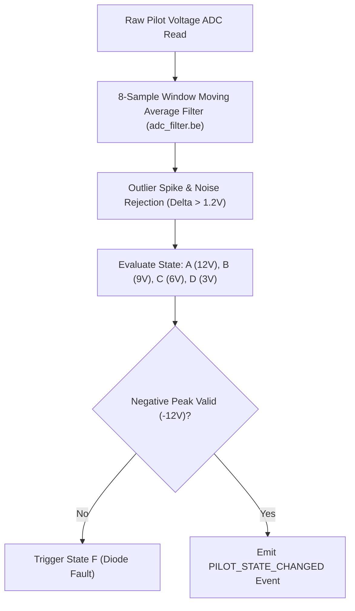

# Stanchion Safety & Hardware Abstraction Layer (HAL)

Electrical vehicle charging equipment interfaces directly with high-voltage AC mains (208V - 480V) and ultra-high-voltage DC buses (up to 1000V DC at 800A). The Stanchion Hardware Abstraction Layer (`hal/`) is designed with a defense-in-depth safety architecture that prioritizes human protection, equipment longevity, and deterministic fault isolation.

---

## 1. IEC 61851-1 Control Pilot Circuit & Signal Conditioning

The Control Pilot (CP) interface is the safety-critical analog signaling channel between the EVSE and the vehicle onboard charger.

### Pilot Signal Specification

The pilot line operates at a nominal $\pm 12\text{ V}$ square wave generated at $1.0\text{ kHz} \pm 0.5\%$:

- **Positive Peak (+12V)**: Dictates the state of vehicle connection and charging readiness.
- **Negative Peak (-12V)**: Used to detect diode failure in the vehicle inlet. If the negative cycle reads near 0V, a missing or shorted diode is detected, and power delivery is blocked immediately.
- **Duty Cycle Mapping**:
  - $10\% \le D \le 85\%$: Maximum Current $= D \times 0.6\text{ A}$ (e.g., $16\% \to 9.6\text{ A}$, $50\% \to 30\text{ A}$).
  - $85\% < D \le 96\%$: Maximum Current $= (D - 64) \times 2.5\text{ A}$ (e.g., $90\% \to 65\text{ A}$).
  - $D = 5\%$: Digital communication required (ISO 15118 PLC handshake).



### Signal Filtering Pipeline

Analog noise from high-frequency inverter switching and ground loops can cause spurious pilot oscillations. The `ADCFilter` (`hal/adc_filter.be`) applies a two-stage filter:
1. **Median Filter Stage**: Strips impulse spikes caused by contactor coil collapse and IGBT switching transients.
2. **Circular Moving Average**: Computes the moving window mean across 8 samples, yielding a noise-immune measurement with sub-millisecond settling time.

---

## 2. Contactor Driver with Dual-Auxiliary Weld Detection

Switching high currents under load risks contactor contact erosion and contact welding. A welded contactor leaves the vehicle connector live even after the session terminates, creating a severe electrocution hazard.

The `ContactorDriver` (`hal/contactor.be`) uses a dual-redundant safety scheme:

```
                      +-----------------------------+
                      |   Contactor Driver Logic    |
                      +-----------------------------+
                                     |
               +---------------------+---------------------+
               |                                           |
               v                                           v
       [ Coil Actuator ]                          [ Aux Sense GPIO ]
       (High-Side Driver)                         (Normally Closed)
               |                                           |
               v                                           v
    +----------------------+                    +----------------------+
    | Main Contact (Power) |                    |  Aux Contact (Sense) |
    +----------------------+                    +----------------------+
```

### Weld Verification Sequence

1. **Pre-Close Check**: Before energizing the coil, the driver verifies that the auxiliary sense contact indicates OPEN status. If current flows or sense indicates closed, the contactor is flagged as welded, and the session is aborted.
2. **Post-Open Check**: When charging stops, the coil is de-energized. After a 50 ms mechanical settling window, the auxiliary feedback is read. If the contacts remain closed, a critical `CONTACTOR_WELD_FAULT` is broadcast, all upstream breakers are signaled, and the connector lock remains engaged to prevent user contact with live pins.

---

## 3. Residual Current Detection (RCD Type B) & Isolation Monitoring

### DC 6mA Residual Current Protection

Standard residential installations use Type A RCDs that blind when DC residual currents exceed 6 mA. Stanchion integrates a Type B RCD monitor (`hal/safety.be`) compliant with IEC 62955:
- **DC Fault Threshold**: 6.0 mA DC residual current.
- **AC Fault Threshold**: 30.0 mA AC residual current.
- **Trip Response Time**: Under 10 ms for critical 30 mA surges, ensuring safe disconnection before ventricular fibrillation thresholds are reached.

### Bender A-ISOMETER Insulation Monitoring (DC Fast Charging)

For ungrounded IT DC charging architectures (up to 1000V DC), isolation resistance between DC+ / DC- and protective earth (PE) must be continuously verified. The `InsulationMonitor` (`hal/insulation_monitor.be`):
- Measures insulation resistance in kOhm via pulse-measuring technology.
- **Warning Threshold**: 500 Ohm/V (e.g., 400 kOhm on an 800V bus).
- **Critical Trip Threshold**: 100 Ohm/V. When triggered, DC main contactors open within 20 ms, and the DC bus discharge resistor is engaged to bleed bus capacitance below 60V within 1.0 second.

---

## 4. Motorized Connector Lock Controller

To prevent connector detachment under high electrical load, Stanchion manages a motorized locking solenoid (`hal/lock.be`):

1. **Locking Sequence**: Triggered when the user is authorized and the pilot reaches State B or C. The H-bridge applies a 200 ms forward pulse to drive the steel locking pin into the connector latch.
2. **Microswitch Feedback Verification**: Optical and mechanical limit switches confirm the pin is fully seated. If the feedback indicates a partial engagement, the motor pulses in reverse and retries up to 3 times before declaring a lock failure.
3. **Emergency Unlocking**: In the event of a station power loss, an onboard supercapacitor provides energy to retract the lock pin safely once contactor opening is confirmed.

---

## 5. Active Cooling Loop Controller (Megawatt Charging System - MCS)

Megawatt charging (up to 800A DC) dissipates significant heat in the charging cable and connector pins:

$$P_{loss} = 2 \cdot I^2 \cdot R_{contact}$$

At 800A with a contact resistance of $0.05\text{ m}\Omega$, contact dissipation reaches 64W per pin, while cable $I^2 R$ losses reach hundreds of watts per meter.

The `CoolingLoopController` (`hal/cooling_loop.be`) orchestrates:
- **PT1000 RTD Sensing**: Dual redundant temperature probes on DC+ and DC- connector pins.
- **Proportional Chiller Regulation**: Dynamically adjusts coolant pump PWM and radiator fan speeds (0-100%) to maintain pin temperatures below 85 C per IEC TS 63379.
- **Thermal Slew Curtailment**: If pin temperature approaches 90 C, the controller automatically issues current curtailment requests to the ISO 15118-20 session engine before thermal shutdown is reached.

---

## 6. Emergency Stop & Cabinet Tamper Monitoring

Stanchion connects all mechanical safety switches to a dedicated interrupt vector (`hal/safety.be`):
- **E-Stop Button**: Dual-channel normally-closed loop. An open circuit trips the safety relay within 5 ms, isolating all contactors without waiting for software evaluation.
- **Cabinet Tamper Switch**: Optical enclosure sensor detects unauthorized cabinet door opening. Generates a high-priority security audit record (`diag/audit_trail.be`) and alerts the central system via OCPP `SecurityEventNotification`.
