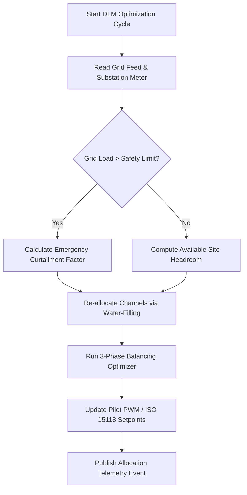
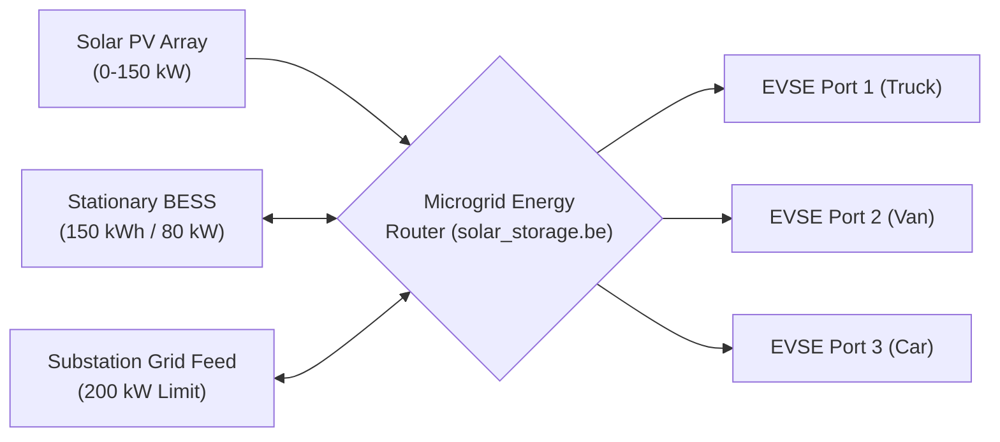

# Stanchion Smart Charging & Microgrid Energy Optimization

Stanchion includes an embedded energy orchestration subsystem capable of managing high-density charging hubs, fleet depots, and microgrids. Operating with sub-second execution intervals, Stanchion balances grid import constraints, localized on-site generation, battery storage buffers, and vehicle charge priorities.

---

## 1. Dynamic Load Management (DLM) Water-Filling Engine

The primary objective of the Dynamic Load Management module (`energy/dlm.be`) is to maximize total energy throughput across active EVSE channels without exceeding site grid import limits or tripping substation breakers.

### Mathematical Formulation

Let $N$ be the set of active charging channels. Each channel $i \in N$ is characterized by:
- $I_{min,i}$: Minimum operational current (typically 6.0 A per IEC 61851-1).
- $I_{max,i}$: Maximum cable and EV onboard charger capability (e.g., 32.0 A for AC, 800.0 A for MCS DC).
- $w_i$: Priority weighting factor based on user tier or departure deadline.
- $I_{cap}$: Total site capacity limit in Amperes.

The allocation problem is formulated as a bounded weighted proportional sharing optimization:

$$\max \sum_{i \in N} w_i \cdot \ln(I_i)$$

Subject to the constraints:

$$\sum_{i \in N} I_i \le I_{cap}$$
$$I_{min,i} \le I_i \le I_{max,i} \quad \forall i \in N$$

### Algorithmic Execution Steps

The algorithm executes in discrete passes:

1. **Safety Floor Allocation**: Every active vehicle is first allocated its minimum required threshold $I_{min,i}$. If $\sum I_{min,i} > I_{cap}$, a shed-load state is triggered, and lowest-priority channels are paused (duty cycle set to 0% or contactors opened).
2. **Weighted Residual Distribution**: Remaining headroom $I_{rem} = I_{cap} - \sum I_{min,i}$ is distributed in proportion to channel weights $w_i$.
3. **Cap Clamping and Iterative Re-distribution**: Any channel that reaches its physical ceiling $I_{max,i}$ is clamped, and its excess allocation is re-pooled into $I_{rem}$ to be distributed among unsaturated channels until convergence.
4. **Hysteresis and Anti-Flapping**: Current setpoint adjustments smaller than 0.5 A or lasting less than 5 seconds are filtered out to prevent unnecessary PWM chatter and vehicle contactor fatigue.

---

## 2. Asymmetric Three-Phase Balancing

In AC charging environments, single-phase electric vehicles (charging on L1 only) create severe current imbalances that can cause neutral line overheating and transformer core saturation.

The `PhaseBalancer` (`energy/phase_balance.be`) tracks real-time phase vector currents:

$$I_{unbalance} = \frac{\max(|I_{L1} - I_{avg}|, |I_{L2} - I_{avg}|, |I_{L3} - I_{avg}|)}{I_{avg}} \times 100\%$$

### Phase Switching and Load Rotation

When phase imbalance exceeds the configured threshold (typically 15% to 20%), the phase balancer coordinates:

1. **Selective Phase Throttling**: Reduces current allocations on the most heavily loaded phase while boosting complementary phases.
2. **Rotational Assignment**: For stations equipped with phase-rotation contactors, single-phase vehicles are assigned cyclic physical rotations (L1-N, L2-N, L3-N) during session initialization to maintain phase symmetry.

---

## 3. Solar PV and Stationary BESS Co-Optimization

The `SolarStorageOptimizer` (`energy/solar_storage.be`) manages multi-source power routing across four distinct energy assets:
1. Grid Import/Export Feed
2. Solar Photovoltaic (PV) Inverter
3. Stationary Battery Energy Storage System (BESS)
4. Electric Vehicle Fleets

### Dispatch Modes and State Logic

| Microgrid Condition | Energy Routing Policy |
| :--- | :--- |
| **Surplus Solar ($P_{PV} > P_{EV}$)** | Route 100% of solar generation to vehicles. Direct remaining surplus into stationary BESS charging until 100% SoC. Zero export to grid if feed-in tariffs are negative or restricted. |
| **Solar Transient Cloud Dip** | When PV generation drops abruptly due to passing cloud cover, BESS immediately transitions from idle or charging to discharge within 50 ms, buffering the exact deficit without drawing additional grid power. |
| **Peak Tariff Window** | During expensive grid peak pricing windows (defined in `energy/tariff.be`), BESS discharges to supply base EV load, shaving commercial demand charges. |
| **Grid Curtailment Signal** | Substation dry-contact or DNP3 signal reduces grid limit. BESS absorbs deficit; if exhausted, DLM water-filling curtails vehicle charge currents. |

---

## 4. Vehicle-to-Grid (V2G) Bidirectional Routing

Stanchion implements ISO 15118-20 Bidirectional Power Transfer (BPT) via `energy/v2g.be` and `protocols/iso15118_20_dc.be`. Electric vehicles act as distributed energy resources (DERs) capable of injecting power back into the microgrid or utility distribution network.

### Battery Preservation and Degradation Limits

To protect vehicle traction batteries from premature degradation, Stanchion enforces strict boundaries:
- **Minimum Discharge SoC**: Discharge ceases immediately when the vehicle SoC reaches the customer-configured reserve threshold (default 20%).
- **Maximum C-Rate Clamp**: Discharge rates are capped at 0.5C or contract-negotiated limits to minimize thermal degradation.
- **Degradation Compensation Credit**: The billing module (`policy/billing.be`) credits the vehicle owner per kWh exported, incorporating battery throughput compensation.

---

## 5. Fast Frequency Response (FFR / FCR) Droop Governor

The `FreqRegulationGovernor` (`energy/freq_regulation.be`) provides synthetic inertia and primary frequency containment reserve (FCR) to stabilize the local utility grid.

### Droop Control Curve

Operating around a nominal grid frequency $f_{nom}$ (50.0 Hz or 60.0 Hz) with an intentional deadband:

$$\Delta f = f_{grid} - f_{nom}$$

- **Deadband ($|\Delta f| \le 0.05\text{ Hz}$)**: Normal operation. No frequency response action taken.
- **Under-Frequency Event ($\Delta f < -0.05\text{ Hz}$)**: Severe grid load or generator trip. Stanchion instantly throttles EV charging current proportionally (droop slope $s = 4\%$). If frequency drops below 49.2 Hz (or 59.2 Hz), EV charging is suspended or switched to V2G discharge.
- **Over-Frequency Event ($\Delta f > +0.05\text{ Hz}$)**: Grid generation surplus. Charging stations absorb excess power by ramping vehicle charge currents up to maximum rated ratings.

---

## 6. Transformer Thermal Aging Model

High-power fast charging can degrade distribution transformers. Stanchion embeds an Arrhenius-based thermal aging model (`energy/thermal_model.be`) adhering to IEC 60076-7:

$$\theta_h = \theta_a + \Delta \theta_{or} \cdot \left(\frac{1 + R \cdot K^2}{1 + R}\right)^x + \Delta \theta_{hr} \cdot K^y$$

Where:
- $\theta_h$: Hotspot temperature in degrees Celsius.
- $\theta_a$: Ambient temperature.
- $K = I_{load} / I_{rated}$: Transformer loading ratio.
- $V = 2^{(\theta_h - 110) / 6}$: Relative aging rate (reference hotspot 110 C).

When hotspot temperature exceeds rated continuous limits (120 C), Stanchion calculates a proportional thermal curtailment factor:

$$\alpha_{therm} = \max\left(0.2, 1.0 - \frac{\theta_h - 120.0}{25.0}\right)$$

This factor scales the maximum site capacity before DLM distributes current to vehicles, ensuring electrical infrastructure longevity.
